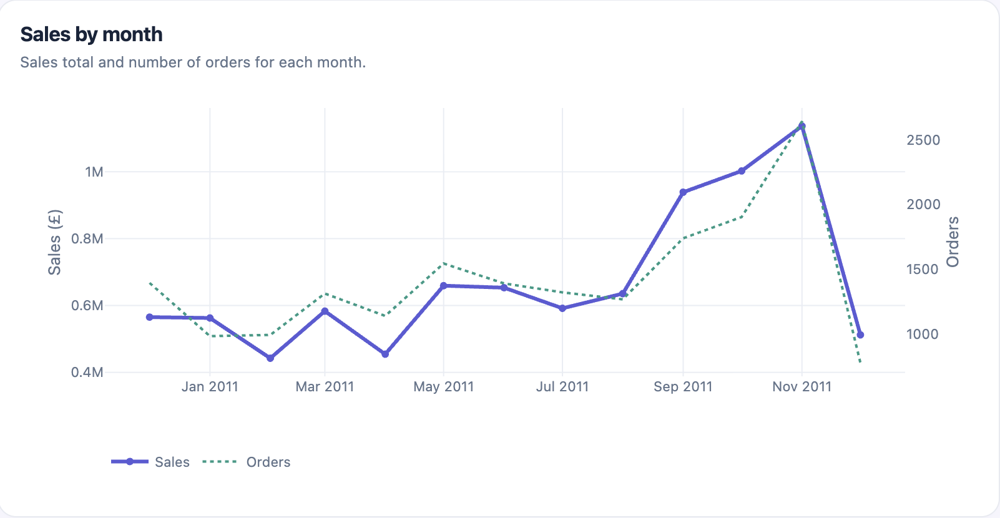
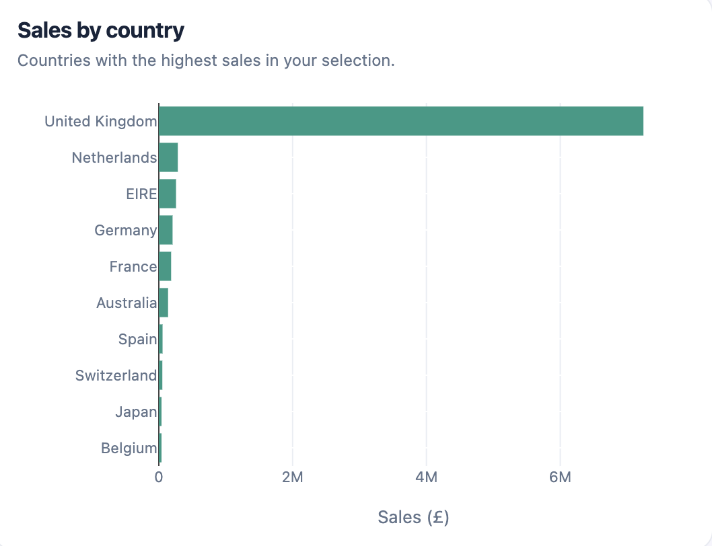
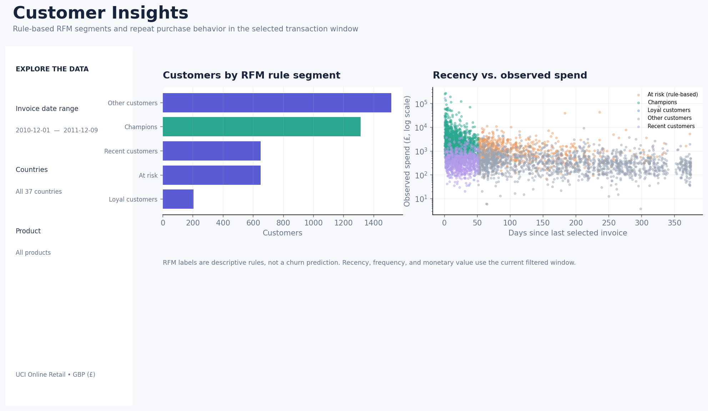

# 🛍️ Shopwise
### Real retail data. Better insights. Smarter decisions.

**Python • pandas • Plotly • Streamlit • Data Analytics**

Built by **Vaishnavi Madagiri** | M.S. Data Science, Virginia Tech

### 💜 [Explore the Live Dashboard](https://shopwise-vm.streamlit.app/)

---

## 💡 Why I Built Shopwise

I wanted to see what real shopping transactions could tell us about a business.

Which products bring in the most sales? When do customers shop the most? How many customers come back? And can we identify different shopping patterns?

Instead of stopping at a few charts, I built Shopwise to turn messy retail transactions into an interactive dashboard where anyone can explore the results.

My goal was to make the analysis useful, understandable, and easy to reproduce.

## 📊 What You Can Explore

Shopwise includes four areas:

- **Sales Overview:** Revenue, orders, average order value, and monthly sales trends.
- **Customer Insights:** Repeat purchases and customer segmentation using recency, frequency, and monetary value (RFM).
- **Products & Countries:** Best-selling products and geographic sales performance.
- **Cohort Retention:** How customers return across different purchase periods.

Interactive filters let you explore different dates, countries, and products.

## 🔎 What I Found

Here are some highlights from the cleaned dataset:

| Metric | Result |
|---|---|
| Total merchandise sales | £8.74 million |
| Unique orders | 18,402 |
| Identified customers | 4,334 |
| Repeat customers | 65.3% |
| Unique stock codes | 3,659 |
| Countries represented | 37 |
| Highest-sales month | November 2011 |

These figures describe the full cleaned dataset, not necessarily a filtered dashboard view.

One important limitation: December 2011 only includes transactions through December 9, so its lower monthly sales should not be interpreted as a complete-month decline.

[Read the detailed findings](real_data_dashboard/FINDINGS.md)

## 🛠️ How I Built It

I used the real **UCI Online Retail dataset**, which contains 541,909 transaction records from a UK-based online retailer.

The original data needed cleaning before I could trust the results.

Using Python and pandas, I built a reproducible pipeline that:

1. Downloads and checks the original dataset.
2. Identifies missing values and duplicate records.
3. Separates cancellations and excludes invalid sales records.
4. Keeps an audit of excluded transactions and cleaning decisions.
5. Produces a cleaned dataset for analysis.

The pipeline retained **391,150 merchandise line items** after cleaning.

I then used Plotly and Streamlit to build the interactive dashboard.

I also included automated tests to check the cleaning rules and calculations.

### Technology Stack

| Technology | Purpose |
|---|---|
| Python | Data processing and application logic |
| pandas | Data cleaning and analysis |
| Plotly | Interactive visualizations |
| Streamlit | Dashboard interface |
| pytest | Automated validation |
| GitHub | Version control and documentation |

## 🖼️ Dashboard Preview

### Sales Trends



### Geographic Performance



### Customer Insights



**[💜 Explore Shopwise Live](https://shopwise-vm.streamlit.app/)**

## 📁 Project Structure

```text
shopwise/
├── README.md
├── .gitignore
└── real_data_dashboard/
    ├── app.py
    ├── analytics.py
    ├── data_pipeline.py
    ├── download_data.py
    ├── shared.py
    ├── pages/
    ├── data/
    ├── screenshots/
    ├── tests/
    ├── requirements.txt
    ├── DATA_CLEANING.md
    ├── DATA_DICTIONARY.md
    └── FINDINGS.md
```

## 💻 Run Shopwise Locally

Clone the repository:

```bash
git clone https://github.com/vmadagiri/shopwise.git
cd shopwise
```

Install dependencies, download the dataset, and prepare the data:

```bash
python -m pip install -r real_data_dashboard/requirements.txt
python real_data_dashboard/download_data.py
python real_data_dashboard/data_pipeline.py
```

Launch the dashboard:

```bash
python -m streamlit run real_data_dashboard/app.py
```

Run the automated tests:

```bash
python -m pytest real_data_dashboard/tests/
```

## 📚 Dataset and Limitations

**Dataset:** [UCI Online Retail](https://archive.ics.uci.edu/dataset/352/online%2Bretail)

**Citation:** Chen, D. (2015). *Online Retail*. UCI Machine Learning Repository. [DOI: 10.24432/C5BW33](https://doi.org/10.24432/C5BW33).

**License:** [CC BY 4.0](https://creativecommons.org/licenses/by/4.0/)

The dataset covers transactions from December 2010 through December 2011.

Revenue represents recorded merchandise sales, not profit. Customer segments and retention patterns are descriptive, not predictions of future behavior.

For more detail, see the [data cleaning methodology](real_data_dashboard/DATA_CLEANING.md) and [data dictionary](real_data_dashboard/DATA_DICTIONARY.md).

## 💗 About Me

Hi! I'm **Vaishnavi**, a Data Science master's student at Virginia Tech with a background in Bioinformatics and Computer Science.

I enjoy building projects that combine programming, problem-solving, and data visualization. Shopwise gave me the opportunity to work with messy real-world data and turn it into something people can actually explore.

### Let's Connect

[💼 LinkedIn](https://www.linkedin.com/in/vaishnavi-madagiri-b0a08b265) • [🐙 GitHub](https://github.com/vmadagiri) • [🛍️ Live Dashboard](https://shopwise-vm.streamlit.app/)
