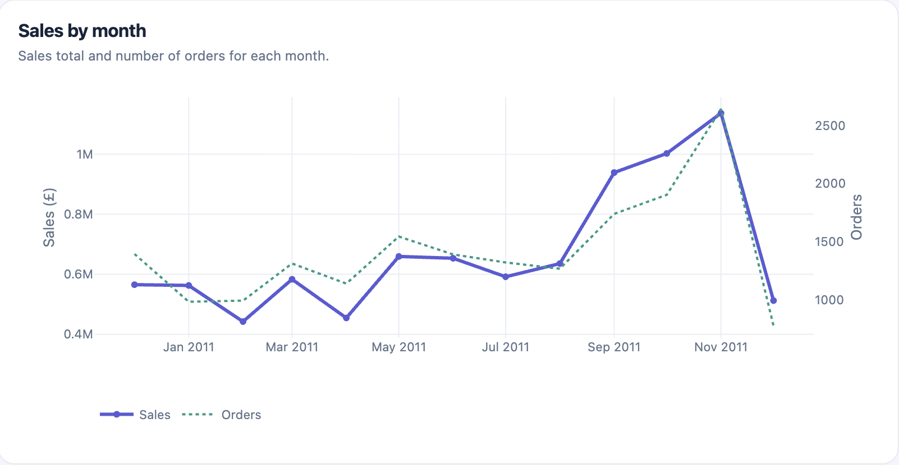
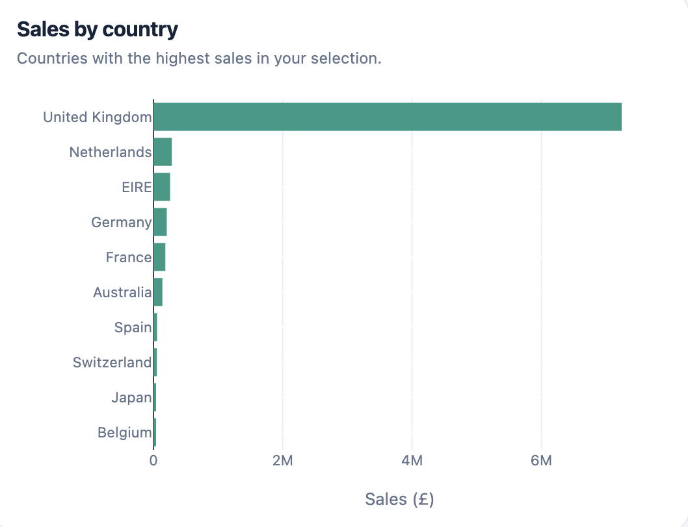

# 🛍️ Customer Shopping Analytics

### Real shopping data, pretty charts and a little curiosity 💗

**Python • Pandas • Plotly • Streamlit • Data Analytics**

*Made by Vaishnavi Madagiri | MS Data Science @ Virginia Tech*

### 🌷 [✨ Explore My Live Dashboard ✨](https://online-retail-analytics.vaishnavimadagiri.chatgpt.site/)

---

## 💌 The Idea Behind This Project

I love finding patterns in data, but I also love making things look good and easy to understand.

For this project, I wanted to take real shopping data and figure out what it could tell me about how people shop.

What are customers buying? When are sales the highest? Do people come back after their first purchase?

I didn't want to just analyze the numbers and call it a day. I wanted to make something interactive where anyone could explore the data themselves.

So I built a customer analytics dashboard!

## 🎯 The Goal

The goal was pretty simple: **turn real retail transactions into useful insights that could help a business understand its customers.**

I focused on five questions:

- 🛍️ What products are people buying?
- 📈 When do sales increase or decrease?
- 🌍 Where are customers shopping from?
- 💗 How many customers come back?
- ✨ What can different shopping patterns tell us?

I also wanted the dashboard to be beginner-friendly. You shouldn't need to know Python or data science to understand what you're looking at.

---

## 🌸 A Look at the Dashboard

These are screenshots from my live dashboard, built using real UCI Online Retail data.

### 💜 How Sales Changed Over Time

I wanted to see how sales and the number of orders changed throughout the year.



November 2011 stood out as the strongest month for sales in the cleaned dataset.

One thing worth mentioning is that December 2011 only includes the first nine days, so its drop doesn't necessarily mean customers suddenly stopped shopping.

### 🌍 Where Customers Are Shopping

I also looked at which countries generated the most sales.



The United Kingdom made up most of the revenue, which makes sense given that the retailer was based there.

But I also thought it was interesting to explore how other countries compared.

### 🎀 Explore It Yourself!

The best part is that you don't have to rely on these screenshots.

The live dashboard lets you explore dates, countries, products and customer patterns through interactive charts and filters.

**[💗 Open My Live Interactive Dashboard](https://online-retail-analytics.vaishnavimadagiri.chatgpt.site/)**

---

## 📊 What I Found

Here are a few highlights from my cleaned retail dataset:

| What I Looked At | What I Found |
|---|---|
| 💰 Total sales | £8.74 million |
| 🧾 Unique orders | 18,402 |
| 👥 Identified customers | 4,334 |
| 💗 Repeat customers | 65.3% placed more than one order |
| 📈 Highest-sales month | November 2011 |
| 🌍 Biggest market | United Kingdom |
| 🛍️ Products analyzed | 3,659 unique stock codes |

These numbers came from the cleaned data, not the raw spreadsheet.

Something I learned pretty quickly was that the way you clean your data really matters. Including canceled orders, duplicate entries or invalid transactions could change the results.

You can read more in my [analysis and findings](real_data_dashboard/FINDINGS.md).

---

## 🛠️ How I Built It

I started with a real retail dataset from the UCI Machine Learning Repository.

Since the data wasn't perfectly ready to analyze, I used Python and Pandas to clean it.

That meant:

- Checking for missing information
- Finding duplicate records
- Separating canceled orders
- Removing invalid transactions
- Checking that the final numbers made sense

Once the data was ready, I used Plotly to create interactive charts and Streamlit to build the Python dashboard.

I also documented my cleaning decisions because I wanted anyone looking at the project to understand how I got my results.

### The Tools

| Tool | What I Used It For |
|---|---|
| 🐍 Python | Cleaning and analyzing data |
| 🐼 Pandas | Working with retail transactions |
| 📊 Plotly | Interactive visualizations |
| 🖥️ Streamlit | Building the Python dashboard |
| 💻 GitHub | Organizing and sharing my project |

---

## 📂 Take a Look Behind the Scenes

If you're curious about the actual work, here's where you can find everything:

| | |
|---|---|
| 💻 [Dashboard Code](real_data_dashboard/) | The Python project |
| 🧹 [Data Cleaning](real_data_dashboard/DATA_CLEANING.md) | How I prepared the data |
| 📊 [My Findings](real_data_dashboard/FINDINGS.md) | Results and observations |
| 📖 [Data Dictionary](real_data_dashboard/DATA_DICTIONARY.md) | What the columns mean |
| 🖼️ [Dashboard Screenshots](real_data_dashboard/screenshots/) | Visual previews |
| 🧪 [Tests](real_data_dashboard/tests/) | Checks for the data workflow |

### Want to Run the Python Version?

From the repository folder, run:

```bash
python -m pip install -r real_data_dashboard/requirements.txt
python real_data_dashboard/download_data.py
python real_data_dashboard/data_pipeline.py
python -m streamlit run real_data_dashboard/app.py
```

The code downloads the original retail dataset, cleans it locally and opens the Python dashboard.

The live website linked above is a separately hosted interactive experience. The GitHub Python version contains the documented data-processing and analysis workflow.

---

## 📚 Where the Data Came From

I used the **UCI Online Retail dataset**, which contains real transactions from a UK-based online retailer between December 2010 and December 2011.

The original dataset has 541,909 rows. After applying my documented cleaning rules, the analysis retained 391,150 merchandise line items.

**Source:** [UCI Online Retail Dataset](https://archive.ics.uci.edu/dataset/352/online%2Bretail)

**Attribution:** Chen, D. (2015). *Online Retail* [Dataset]. UCI Machine Learning Repository. [DOI: 10.24432/C5BW33](https://doi.org/10.24432/C5BW33).

**License:** [Creative Commons Attribution 4.0](https://creativecommons.org/licenses/by/4.0/)

A quick note: the dataset records sales, not profit. Customer groups and repeat-purchase patterns describe what happened during the observed period, not what customers will necessarily do in the future.

---

## 🌱 What I Learned

One of my favorite things about this project was realizing that data analysis isn't just about getting the right numbers.

It's also about making sure someone else can understand them.

I got more comfortable working with messy real-world data, building reusable Python code and thinking through how my visualizations would look to someone who had never seen the dataset before.

I also learned that a good-looking dashboard still needs reliable data behind it.

This project was a fun way to combine the technical side of data science with something I genuinely enjoy: making information visual, interactive and easy to explore.

---

## 💗 A Little About Me

Hi! I'm **Vaishnavi**, a Data Science master's student at Virginia Tech with a background in Bioinformatics and Computer Science.

I enjoy building projects that combine programming, problem-solving and data visualization.

I'm especially interested in data science, analytics and creating tools that people can actually use.

### Let's Connect!

[🌷 Live Dashboard](https://online-retail-analytics.vaishnavimadagiri.chatgpt.site/) • [💼 LinkedIn](https://www.linkedin.com/in/vaishnavi-madagiri-b0a08b265) • [🐙 GitHub](https://github.com/vmadagiri)

*Made with curiosity, coffee and lots of Python. 💕*
